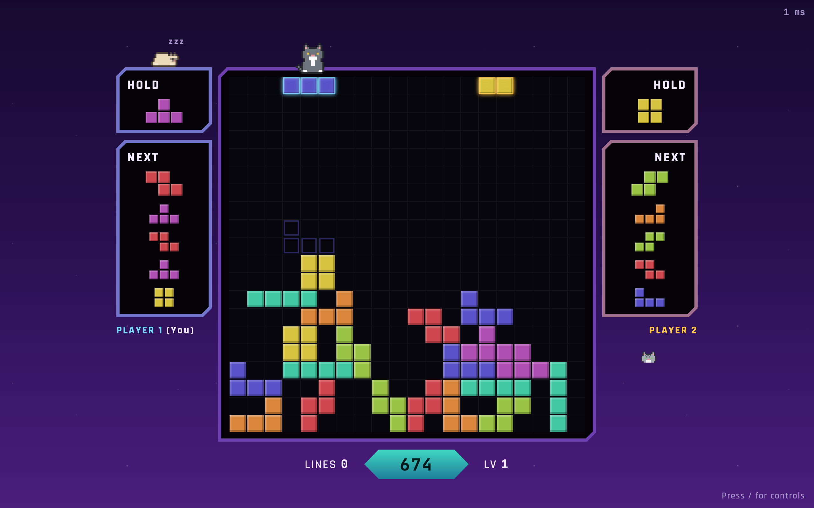
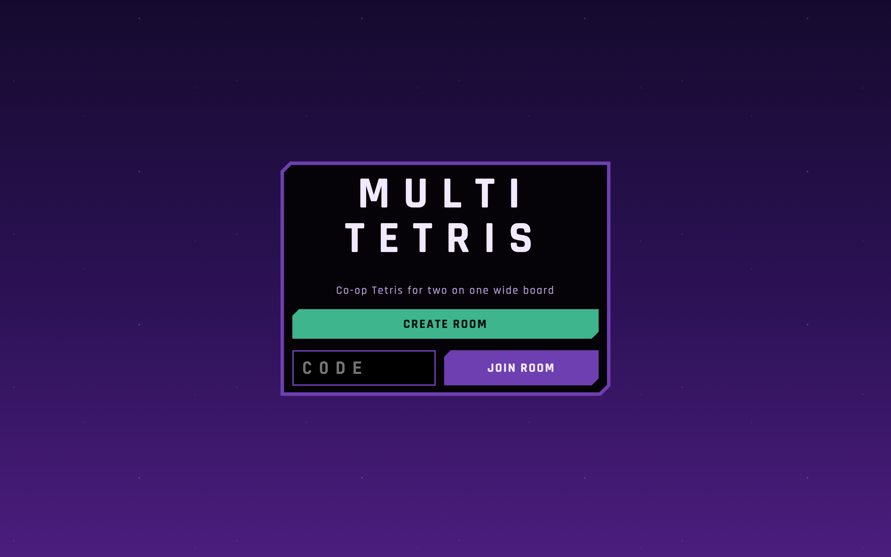
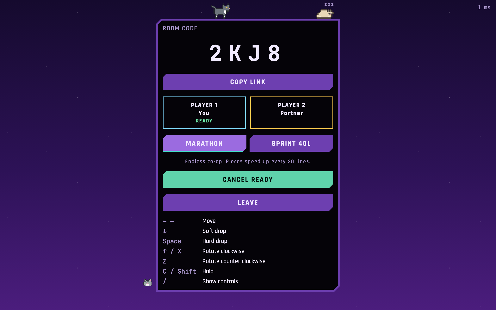

# Multi Tetris

Co-op Tetris for two players on one shared 20-wide well. Create a room, send the link, play.

**Play it live: [multi-tetris.fly.dev](https://multi-tetris.fly.dev/)** — open it, create a room, and send the link to a friend (or open it in a second window).



| Home                                      | Lobby                                                               |
| ----------------------------------------- | ------------------------------------------------------------------- |
|  |  |

## How it plays

- Two modes, picked in the lobby by either player: **Marathon** (endless; pieces speed up every 20 lines) and **Sprint 40L** (clear 40 lines together as fast as you can at a fixed speed; the results screen shows your time).
- Both players drop pieces into the same 20-column well at the same time and share one score.
- Active pieces are solid to each other; a piece resting on your partner's falling piece hovers instead of locking.
- Each player has their own hold slot and 5-piece next queue, shown on their side of the well.
- Standard guideline controls: SRS rotation with wall kicks, DAS/ARR, soft drop, hard drop, hold.

| Key       | Action                   |
| --------- | ------------------------ |
| ← →       | Move                     |
| ↓         | Soft drop                |
| Space     | Hard drop                |
| ↑ / X     | Rotate clockwise         |
| Z         | Rotate counter-clockwise |
| C / Shift | Hold                     |
| /         | Show controls            |

## How it works

- `packages/engine` — pure, deterministic, tick-based game rules (60 ticks/s) plus the client/server protocol. Shared by both sides.
- `packages/server` — Node + WebSockets. Each room runs the authoritative game loop, broadcasts snapshots at 30 Hz, pauses for up to 30 s if a player disconnects, and serves the built client.
- `packages/client` — Vite + React UI with a canvas board. Your own inputs are applied instantly through the shared engine (client-side prediction) and reconciled with server snapshots.

## Develop

Requires Node 22+.

```bash
npm install
npm run dev        # server on :8080, client on http://localhost:5173
npm test           # unit + integration tests
npm run e2e        # Playwright smoke test (builds first)
npm run typecheck && npm run lint && npm run format:check
```

## Deploy (Fly.io)

The app is deployed at **https://multi-tetris.fly.dev/** as a single Node service (Dockerfile in the repo root) that serves the client and the `/ws` WebSocket endpoint. Health check: `GET /healthz`.

> **Rooms live in memory, so the app must run on exactly one machine.** With more than one, two players can land on different machines and never find each other's room.

### One-time setup

```bash
brew install flyctl
fly auth login
fly launch --no-deploy --copy-config --name <your-unique-app-name>   # creates the app, updates fly.toml
fly deploy --ha=false                                                # first deploy, single machine
fly scale count 1                                                    # make sure only one machine runs
fly status                                                           # should list exactly one machine
```

### Continuous deployment

Every push to `main` runs the CI workflow (typecheck, lint, format check, unit tests, Playwright e2e) and, only if it passes, deploys with `flyctl deploy --remote-only --ha=false` (`.github/workflows/deploy.yml`).

It needs one repository secret:

1. Create a deploy token: `fly tokens create deploy -a <your-app-name>` (copy the whole `FlyV1 …` string).
2. On GitHub: **Settings → Secrets and variables → Actions → New repository secret**, name it `FLY_API_TOKEN`, paste the token.

### Deploying by hand

```bash
fly deploy --ha=false
```

Useful commands: `fly status` (machines), `fly logs` (server logs), `fly scale count 1` (if a second machine ever appears).
